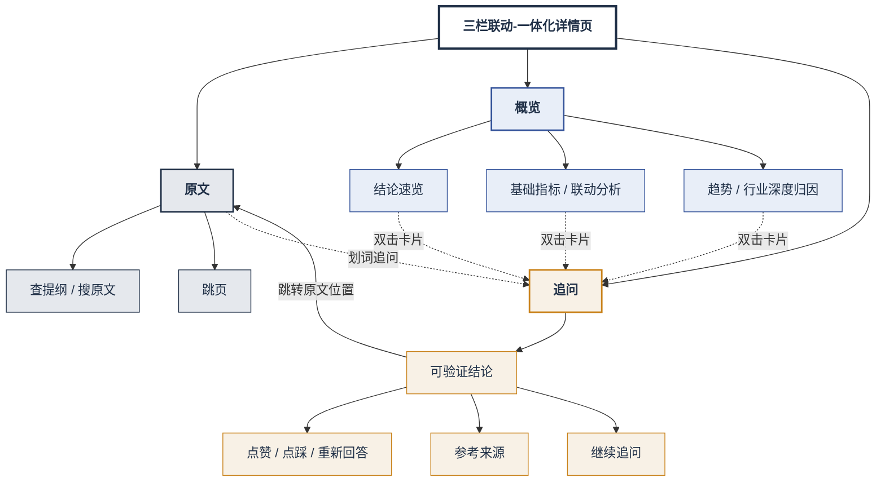

# 产品介绍

Eva（财报智析）—— 一个面向 A 股上市公司财报的智能阅读与分析工具。
把交易所公开财报 PDF，变成可查询、可对比、可点回原文的阅读台。

## 适合谁

- 需要快速看懂一家公司最新正式报告的经营表现
- 需要核对数字是否来自官方披露，而不是只能信摘要
- 需要围绕同一份报告追问变化原因，并回到 PDF 页核对

不适合：寻求荐股、目标价或「能不能买」的结论。产品不做证券买卖建议。

## 怎么用

## 核心能力

| 能力 | 说明 |
|---|---|
| 找公司进财报 | 首页按全称、代码、简称、拼音检索；可收藏、按行业筛选 |
| 一站式三栏阅读 | 左栏 PDF 原文 · 中栏结构化概览 · 右栏带出处的追问 |
| 四项核心指标 | 营业收入、归母净利润、基本每股收益、净资产收益率；保留字段名与页码 |
| 角标回原文 | 指标与问答中的页码可跳左栏并高亮，方便核验 |
| 指标联动 | 程序核对少数硬关系，展开看数据与提示；可记作「红绿灯」——一眼扫背离/健康风险 |
| 多期趋势 | 仅用已入库真实报告期；同比用上年同期，季报与年报不混算 |
| 深度归因 | 结合行业维度解读变化；有料优先 |
| 智能追问 | 结构化数据 + 页文本证据；答案带页码；题外话短答 + 软提示 |
| 实时语音 | 连续口述提问、跟页、切期次；可结束会话 |
| 数据采集 | `/sources` 看清发现 → 下载 → 解析 → 智析；多源、温和并发 |
| 状态透明 | 已上线 / 待复核 / 部分解析等如实展示，不拿模拟数填空 |
